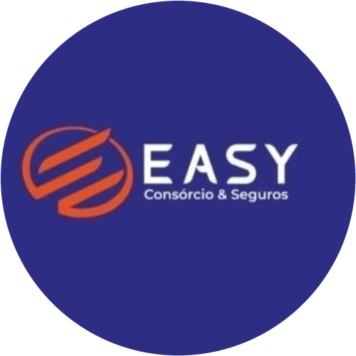

<p align="center">
  
</p>

<h1 align="center">GE EASY — Gestão Especializada EASY</h1>
<p align="center">Plataforma de <b>gestão jurídica</b> da EASY: processos, prazos, audiências e gestão por departamentos —
com agenda integrada ao Google, documentos no Drive e o módulo comercial de consórcios e seguros.</p>

---

## Módulos

| Módulo | O que faz |
|---|---|
| **Painel jurídico** | Prazos vencidos/próximos, audiências, carteira por área e fase, provisões e visão por departamento. |
| **Processos** | Nº CNJ validado, partes, linha do tempo de andamentos, custas e honorários, equipe e risco (provável/possível/remoto). |
| **Prazos** | Contagem em dias úteis (CPC), feriados e recesso forense, alertas diários, calculadora de prazos. |
| **Audiências** | Agenda de audiências integrada ao Google Agenda, redesignação e resultado. |
| **Departamentos** | Equipes, responsáveis, demandas (kanban), carga de trabalho e indicadores de cada área. |
| **Painel comercial** | (Módulo comercial) produção de consórcios e seguros, funil, renovações, metas e ranking. |
| **Clientes (CRM)** | Cadastro PF/PJ com validação de CPF/CNPJ, linha do tempo de contatos, negócios, agenda e documentos. |
| **Funil de vendas** | Kanban com arrastar-e-soltar, previsão ponderada, motivo de perda e conversão. |
| **Consórcios** | Cotas, grupos, parcelas, lances, assembleias e contemplações + simulador com comparação ao financiamento. |
| **Seguros** | Apólices, vigências, renovações (alertas automáticos), sinistros e geração de renovação em 1 clique. |
| **Agenda** | Mês/semana/lista, sincronização com **Google Agenda** e exportação **.ics**. |
| **Tarefas** | Atrasadas/hoje/próximas, prioridades e responsáveis. |
| **Visitas & check-in** | App de campo para consultores externos com geolocalização, check-in/check-out e resultado. |
| **Comissões** | Geradas automaticamente pelo banco ao ativar cota/emitir apólice; recebimento e repasse em lote. |
| **Metas & ranking** | Metas por consultor/equipe, realizado automático e pódio. |
| **Consultores** | Gestão de consultores internos e externos: carteira, produção, visitas e comissões. |
| **Documentos** | Upload seguro (Supabase Storage privado) com envio ao **Google Drive** do usuário. |
| **Relatórios** | Produção por consultor/administradora/seguradora, carteira, conversão; impressão/PDF e CSV. |
| **Configurações** | Perfil, 2FA (TOTP), integrações, usuários e papéis, cadastros, auditoria e dados da empresa. |

## Segurança
- **RLS em todas as tabelas** + funções auxiliares `SECURITY DEFINER` com `search_path` vazio.
- Papéis: `admin`, `gestor`, `financeiro`, `consultor`, `consultor_externo` — consultores só enxergam a própria carteira.
- Triggers impedem auto-escalonamento de privilégios e transferência de carteira por não gestores.
- **Auditoria** completa (quem, quando, antes/depois) nas tabelas de negócio.
- Autenticação Supabase com **2FA TOTP** obrigatório quando ativado (nível AAL2 verificado no middleware).
- Tokens do Google criptografados com **AES-256-GCM**; tabela acessível somente pelo service role.
- Cabeçalhos: CSP restritiva, HSTS, `X-Frame-Options: DENY`, `nosniff`, `Permissions-Policy`.
- Validação com **zod** em todas as Server Actions, proteção contra CSV injection, redirecionamentos seguros.

Detalhes em [`docs/SEGURANCA.md`](docs/SEGURANCA.md).

## Como rodar

```bash
npm install
cp .env.example .env.local   # preencha as variáveis
npm run dev                  # http://localhost:3000
```

O **primeiro usuário** que se cadastrar no Supabase vira administrador. Depois disso, novos usuários entram
inativos (aguardando aprovação) ou são convidados pelo admin em *Configurações › Usuários*.

Implantação (Vercel + Supabase + Google Cloud) em [`docs/IMPLANTACAO.md`](docs/IMPLANTACAO.md).

## Scripts
`npm run dev` · `npm run build` · `npm run typecheck` · `npm run lint` · `npm test`

## Estrutura
```
supabase/migrations/     esquema, RLS, triggers, storage e cron
src/app/(auth)/          login, recuperação de senha, 2FA
src/app/(app)/           módulos do sistema (rotas protegidas)
src/app/api/             exportações CSV, agenda .ics, OAuth Google
src/components/ui/       design system
src/lib/                 auth, RBAC, Supabase, Google, criptografia, Server Actions
docs/                    arquitetura, segurança, módulos e implantação
```
